# SDK dialog audit

Every SDK dialog and the login modal, before and after the fixes on `sdk-modal-ux`. The images come from the development-only gallery at `/dev-modals` (`app/dev-modals`, a 404 in production builds and not bundled there), captured with `node research/ui-audit/capture.mjs <dir>` against `npx next dev -p 3100`, in light and dark, at 1280px and 360px.

`before/` is the code at `7925922` (idle and error states only: busy, countdown, expired and success didn't exist). `after/` is this branch.

## The numbered fixes

| # | Before | Fix | Before (360, light) | After (360, light) |
|---|---|---|---|---|
| 1 | Approval expired before its code: the request lived 5 minutes, the code and the prompt said 10. Resend and confirm after 5 minutes failed with "Signing confirmation is invalid or expired". | Sending a code moves the request's expiry to the code's (now + 10 minutes) and every resend extends both again; the per-user limit (5 codes per 10 minutes) is unchanged. A request past its expiry fails with "This request expired. Start again." and the prompt shows that with a Close button. Covers transaction, settings, payment, recovery and recovery-backup. Postgres tests: resend after 6 min works, confirm after 6 min works, both fail plainly after expiry (`tests/general-signing-postgres.test.ts`, `tests/fiber-payments-postgres.test.ts`, `tests/recovery-postgres.test.ts`). | — | 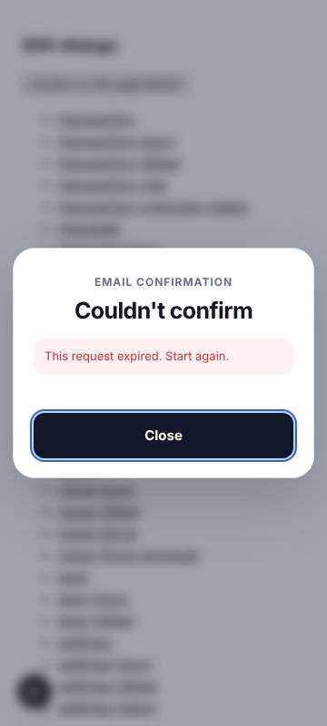 |
| 2 | Resend failures were silent: the button just reset. | Shared `ResendLine`: shows the server's message ("Too many codes sent. Try again in 7 minutes"), or "New code sent. Send another in 30s" with a countdown before the next resend. | 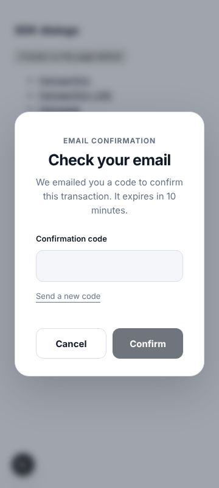 | 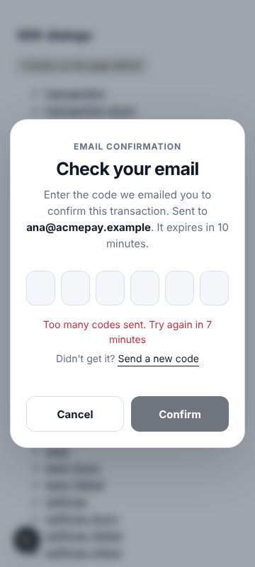 |
| 2b |  | Countdown after a successful resend. | — | 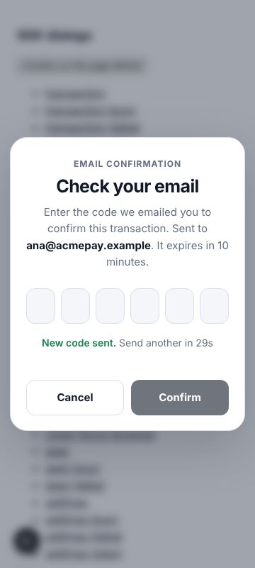 |
| 3 | The code prompt was a letter-spaced text field; the login used six boxes. | One `CodeInput` shared by both: a single numeric `one-time-code` input over six boxes, so paste of a full code, backspace across boxes and autofill work; visible caret on the active box; screen-reader label; `aria-invalid` and `aria-describedby` for errors. | 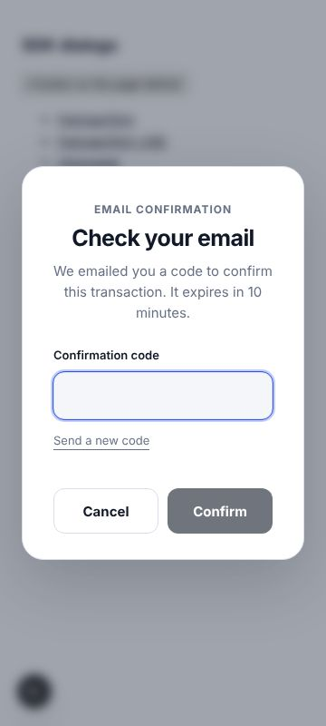 | 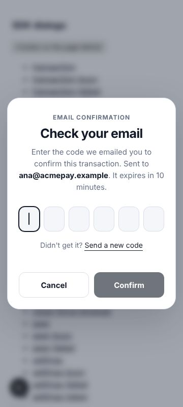 |
| 4 | The prompt closed while the code was checked and came back with an error. | `RequestEmailCode` gets an optional `verify(code)`; the SDK prompt stays open with "Checking code…", shows a wrong code in place (boxes cleared, first box focused) and closes only on success or cancel. Cancel and Escape are disabled while a check runs, and `withEmailCode` waits for a check in flight, so an accepted code is never lost. Apps' own prompts that just return a code work as before. | 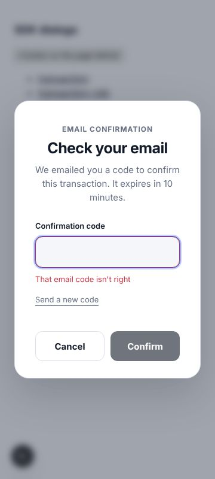 | 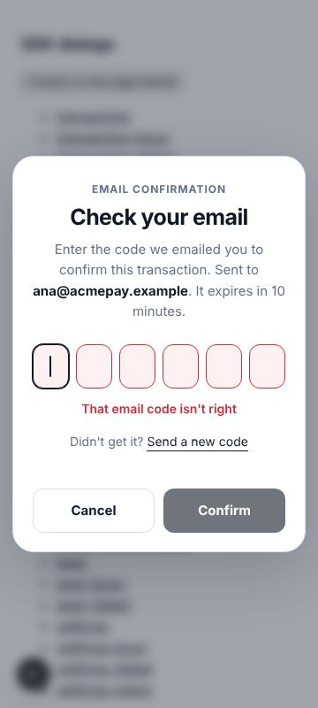 |
| 4b |  | Checking and success states. | — | 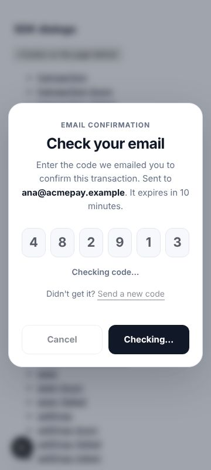 |
| 4c |  |  | — | 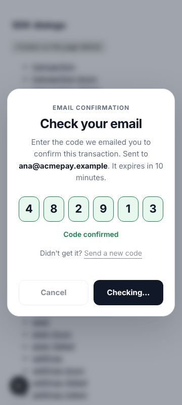 |
| 5 | No auto-submit in the code prompt. | Submits on the sixth digit, like the login. | — |  |
| 6 | The prompt didn't say where the code went. | "Sent to ana@acmepay.example": request-email-code (and the settings request) now return `sentTo`, the signed-in email, unmasked. |  |  |
| 7 | After approving, the dialog vanished and nothing showed for seconds. | Every built-in approval (transaction, message, recovery, backup change, channel close / peer / settings, funding) stays open with a busy primary button ("Sending code…", "Signing…", "Closing…", "Saving…"…) until the code prompt opens or the action finishes, and shows the failure with Close if it fails. Escape is ignored while busy. | 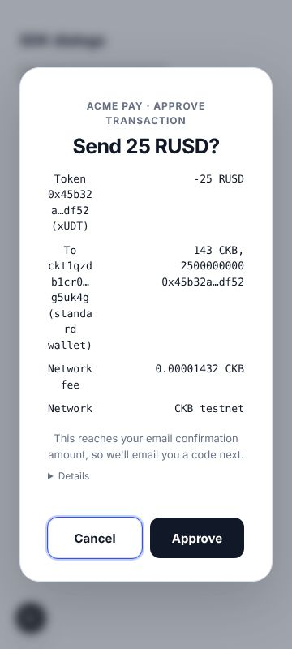 | 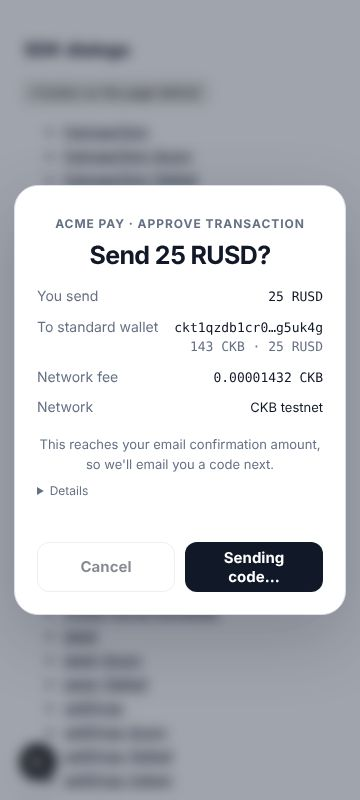 |
| 7b |  | Failure shown in the same dialog. | — | 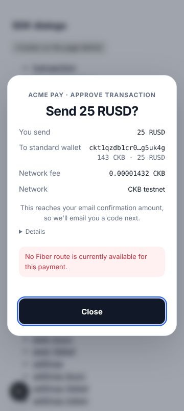 |
| 8 | Channel settings showed "Payment expiry (ms)" and raw numbers. | Hours/minutes, the channel's asset with its decimals (the preview now carries `asset`), the fee as a percentage, on/off. | 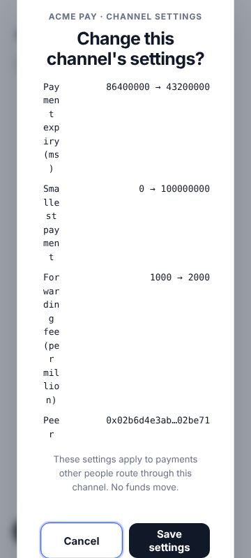 | 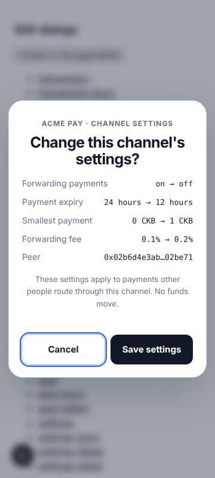 |
| 8b |  | Token channel: smallest payment in RUSD. | — | 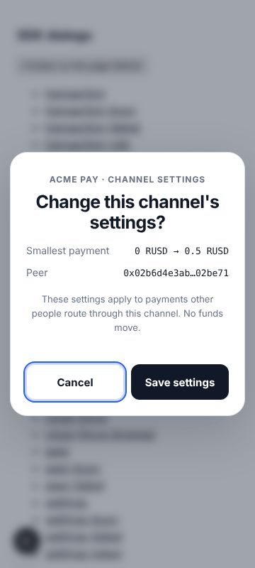 |
| 9 | Force-close copy said funds "may not settle to your own address". | Says what happens: it settles on-chain after about 4 hours and KeyWay moves the user's side to their account (hosted: the next time they use Fiber; browser: while Fiber runs in that browser), per `settlement-sweep.ts` and the docs. | 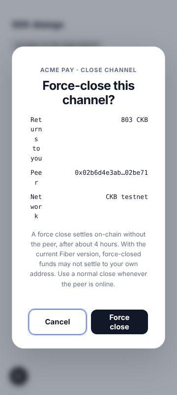 |  |
| 9b |  | Browser node wording. | — | 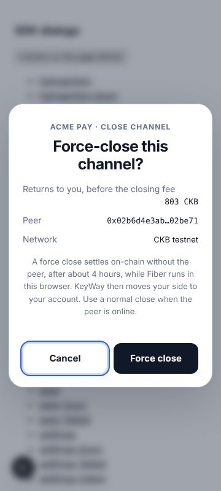 |
| 10 | Token rows read "Token 0x45b32a…df52 (xUDT)"; recipients showed raw units. | "You send 25 RUSD"; recipients show "143 CKB · 25 RUSD"; unknown tokens show the amount with a short id. The server now adds `asset` (full type hash) and recipient `amountText`; the raw id and amount stay in Details. The confirmation email line reads "Token -25 RUSD (xUDT 0x45b32a…df52)". |  |  |
| 10b |  | Unknown token. | — | 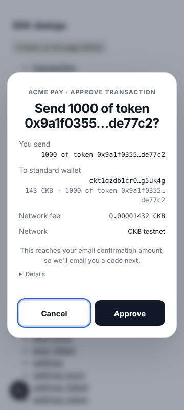 |
| 11 | No focus trap; Tab reached the page behind. | `useDialogFocus` in every dialog, the login included: Tab and Shift+Tab cycle inside, focus that escapes is pulled back, Escape behaves as before, and focus returns to the opener on close, also across approval → code prompt (checked with Playwright on the `flow` scene). | — |  |

## Found in the audit (12)

| Issue | Fix | Before (360, light) | After (360, light) |
|---|---|---|---|
| Detail rows collapsed into one-character columns at 360px (the recovery dialog was unreadable) and values sat 40px off the edge (browser `dd` margin). | Rows are label-left / value-right flex rows that wrap the value under its label when needed; sans-serif muted labels, monospace values. | 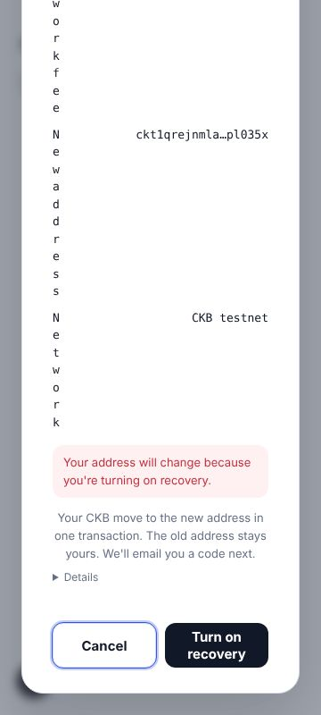 | 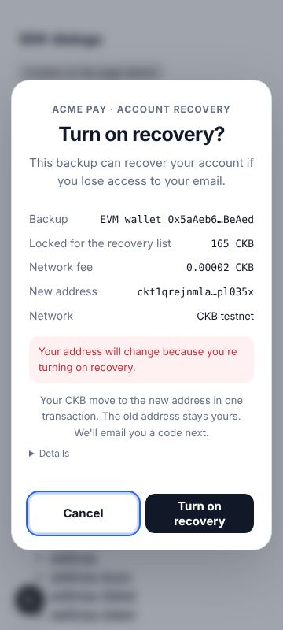 |
| The funding dialog used its own markup: no app name, different width, values not aligned, "Confirm activation" wrapped. | Moved to the shared shell and rows; eyebrow "Acme Pay · On-chain confirmation"; button "Activate"; busy and failure states. | 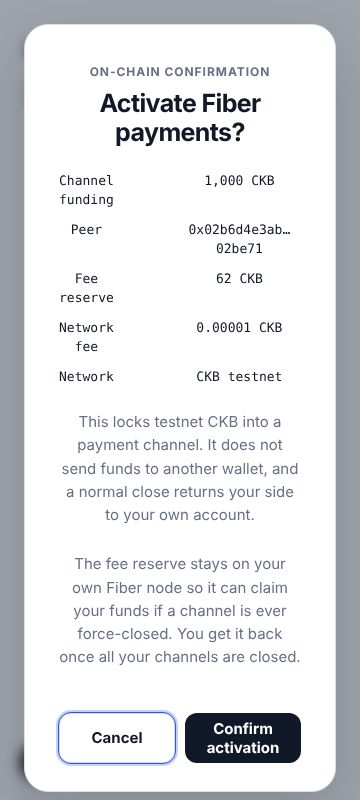 | 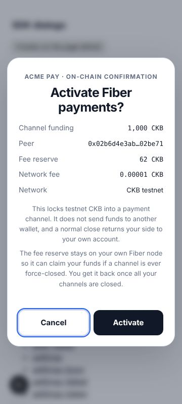 |
| Footnote text ("Secured by CKB KeyWay") failed contrast: 2.6:1 light, 3.7:1 dark. | Palette `subtle` is now 4.8:1 (light) and 5.5:1 (dark); a visible focus ring colour per theme. | 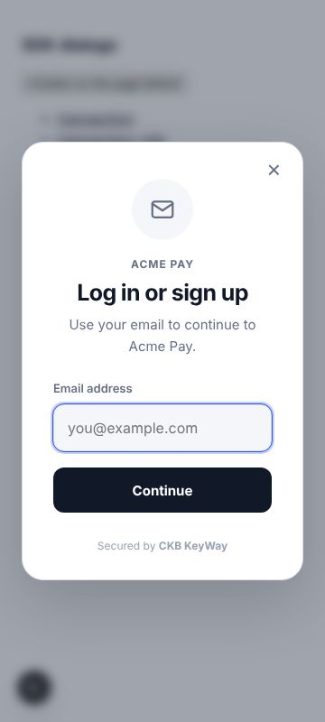 | 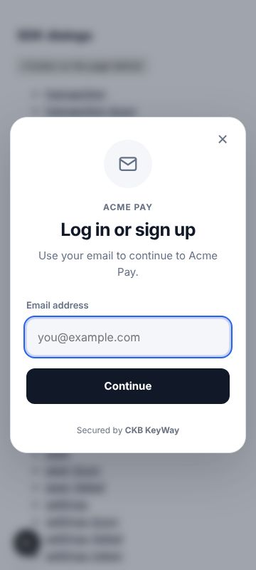 |
| The login mapped every error containing "code" to "Incorrect or expired code", hiding "Too many login codes requested…". | Shows the server's message; a wrong code clears the boxes and focuses the first. | 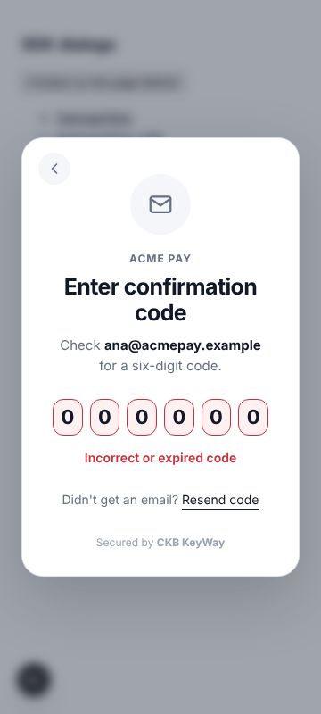 | 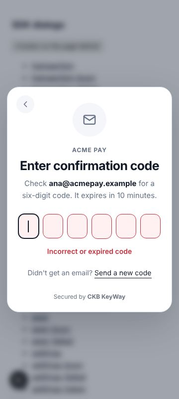 |
| Login resend had no feedback. | Same `ResendLine`, with a 60-second wait to match the server's one-login-code-a-minute limit. | — | 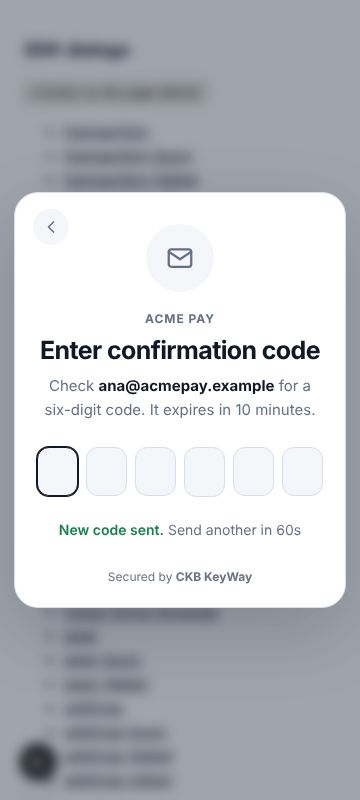 |
| "Code has expired. Request a new one" and "Too many wrong codes" closed the code prompt. | Treated as fixable in place: the prompt stays open so the user can send a new code. | — |  |
| The rate-limit message for codes read "Too many signing requests. Try again in 412 seconds". | "Too many codes sent. Try again in 7 minutes". |  |  |
| "Returns to you" on the close dialog didn't say it is before the closing fee. | "Returns to you, before the closing fee". | 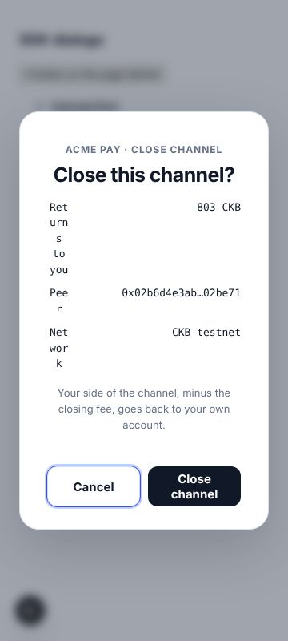 | 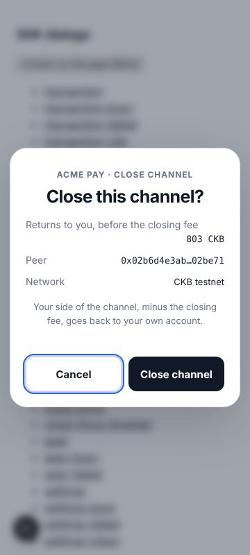 |
| Panel padding left ~240px of content at 360px; button pairs could overflow. | Padding scales with the viewport; action buttons wrap. |  |  |
| A busy primary button would lose focus if disabled. | Busy uses `aria-disabled` and a status region announces the busy label. | — | 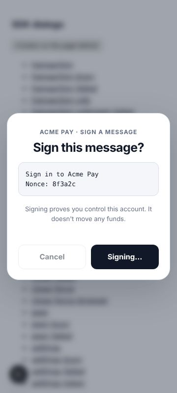 |

## Every scene

Each link is one screenshot. Scene names: `-busy` and `-failed` are an approval after the user approved; `code-*` and `login-*` are the code prompt and the login in each state.

| Scene | Before | After |
|---|---|---|
| `backup` | [light desktop](before/backup-light-desktop.jpg) · [light 360](before/backup-light-360.jpg) · [dark desktop](before/backup-dark-desktop.jpg) · [dark 360](before/backup-dark-360.jpg) | [light desktop](after/backup-light-desktop.jpg) · [light 360](after/backup-light-360.jpg) · [dark desktop](after/backup-dark-desktop.jpg) · [dark 360](after/backup-dark-360.jpg) |
| `backup-busy` | — | [light desktop](after/backup-busy-light-desktop.jpg) · [light 360](after/backup-busy-light-360.jpg) · [dark desktop](after/backup-busy-dark-desktop.jpg) · [dark 360](after/backup-busy-dark-360.jpg) |
| `backup-failed` | — | [light desktop](after/backup-failed-light-desktop.jpg) · [light 360](after/backup-failed-light-360.jpg) · [dark desktop](after/backup-failed-dark-desktop.jpg) · [dark 360](after/backup-failed-dark-360.jpg) |
| `close` | [light desktop](before/close-light-desktop.jpg) · [light 360](before/close-light-360.jpg) · [dark desktop](before/close-dark-desktop.jpg) · [dark 360](before/close-dark-360.jpg) | [light desktop](after/close-light-desktop.jpg) · [light 360](after/close-light-360.jpg) · [dark desktop](after/close-dark-desktop.jpg) · [dark 360](after/close-dark-360.jpg) |
| `close-busy` | — | [light desktop](after/close-busy-light-desktop.jpg) · [light 360](after/close-busy-light-360.jpg) · [dark desktop](after/close-busy-dark-desktop.jpg) · [dark 360](after/close-busy-dark-360.jpg) |
| `close-failed` | — | [light desktop](after/close-failed-light-desktop.jpg) · [light 360](after/close-failed-light-360.jpg) · [dark desktop](after/close-failed-dark-desktop.jpg) · [dark 360](after/close-failed-dark-360.jpg) |
| `close-force` | [light desktop](before/close-force-light-desktop.jpg) · [light 360](before/close-force-light-360.jpg) · [dark desktop](before/close-force-dark-desktop.jpg) · [dark 360](before/close-force-dark-360.jpg) | [light desktop](after/close-force-light-desktop.jpg) · [light 360](after/close-force-light-360.jpg) · [dark desktop](after/close-force-dark-desktop.jpg) · [dark 360](after/close-force-dark-360.jpg) |
| `close-force-browser` | — | [light desktop](after/close-force-browser-light-desktop.jpg) · [light 360](after/close-force-browser-light-360.jpg) · [dark desktop](after/close-force-browser-dark-desktop.jpg) · [dark 360](after/close-force-browser-dark-360.jpg) |
| `code` | [light desktop](before/code-light-desktop.jpg) · [light 360](before/code-light-360.jpg) · [dark desktop](before/code-dark-desktop.jpg) · [dark 360](before/code-dark-360.jpg) | [light desktop](after/code-light-desktop.jpg) · [light 360](after/code-light-360.jpg) · [dark desktop](after/code-dark-desktop.jpg) · [dark 360](after/code-dark-360.jpg) |
| `code-checking` | — | [light desktop](after/code-checking-light-desktop.jpg) · [light 360](after/code-checking-light-360.jpg) · [dark desktop](after/code-checking-dark-desktop.jpg) · [dark 360](after/code-checking-dark-360.jpg) |
| `code-expired` | — | [light desktop](after/code-expired-light-desktop.jpg) · [light 360](after/code-expired-light-360.jpg) · [dark desktop](after/code-expired-dark-desktop.jpg) · [dark 360](after/code-expired-dark-360.jpg) |
| `code-resend-error` | [light desktop](before/code-resend-error-light-desktop.jpg) · [light 360](before/code-resend-error-light-360.jpg) · [dark desktop](before/code-resend-error-dark-desktop.jpg) · [dark 360](before/code-resend-error-dark-360.jpg) | [light desktop](after/code-resend-error-light-desktop.jpg) · [light 360](after/code-resend-error-light-360.jpg) · [dark desktop](after/code-resend-error-dark-desktop.jpg) · [dark 360](after/code-resend-error-dark-360.jpg) |
| `code-resent` | — | [light desktop](after/code-resent-light-desktop.jpg) · [light 360](after/code-resent-light-360.jpg) · [dark desktop](after/code-resent-dark-desktop.jpg) · [dark 360](after/code-resent-dark-360.jpg) |
| `code-settings-no-address` | — | [light desktop](after/code-settings-no-address-light-desktop.jpg) · [light 360](after/code-settings-no-address-light-360.jpg) · [dark desktop](after/code-settings-no-address-dark-desktop.jpg) · [dark 360](after/code-settings-no-address-dark-360.jpg) |
| `code-success` | — | [light desktop](after/code-success-light-desktop.jpg) · [light 360](after/code-success-light-360.jpg) · [dark desktop](after/code-success-dark-desktop.jpg) · [dark 360](after/code-success-dark-360.jpg) |
| `code-wrong` | — | [light desktop](after/code-wrong-light-desktop.jpg) · [light 360](after/code-wrong-light-360.jpg) · [dark desktop](after/code-wrong-dark-desktop.jpg) · [dark 360](after/code-wrong-dark-360.jpg) |
| `funding` | [light desktop](before/funding-light-desktop.jpg) · [light 360](before/funding-light-360.jpg) · [dark desktop](before/funding-dark-desktop.jpg) · [dark 360](before/funding-dark-360.jpg) | [light desktop](after/funding-light-desktop.jpg) · [light 360](after/funding-light-360.jpg) · [dark desktop](after/funding-dark-desktop.jpg) · [dark 360](after/funding-dark-360.jpg) |
| `funding-busy` | — | [light desktop](after/funding-busy-light-desktop.jpg) · [light 360](after/funding-busy-light-360.jpg) · [dark desktop](after/funding-busy-dark-desktop.jpg) · [dark 360](after/funding-busy-dark-360.jpg) |
| `funding-failed` | — | [light desktop](after/funding-failed-light-desktop.jpg) · [light 360](after/funding-failed-light-360.jpg) · [dark desktop](after/funding-failed-dark-desktop.jpg) · [dark 360](after/funding-failed-dark-360.jpg) |
| `login` | [light desktop](before/login-light-desktop.jpg) · [light 360](before/login-light-360.jpg) · [dark desktop](before/login-dark-desktop.jpg) · [dark 360](before/login-dark-360.jpg) | [light desktop](after/login-light-desktop.jpg) · [light 360](after/login-light-360.jpg) · [dark desktop](after/login-dark-desktop.jpg) · [dark 360](after/login-dark-360.jpg) |
| `login-code` | — | [light desktop](after/login-code-light-desktop.jpg) · [light 360](after/login-code-light-360.jpg) · [dark desktop](after/login-code-dark-desktop.jpg) · [dark 360](after/login-code-dark-360.jpg) |
| `login-resent` | — | [light desktop](after/login-resent-light-desktop.jpg) · [light 360](after/login-resent-light-360.jpg) · [dark desktop](after/login-resent-dark-desktop.jpg) · [dark 360](after/login-resent-dark-360.jpg) |
| `login-slow` | [light desktop](before/login-slow-light-desktop.jpg) · [light 360](before/login-slow-light-360.jpg) · [dark desktop](before/login-slow-dark-desktop.jpg) · [dark 360](before/login-slow-dark-360.jpg) | [light desktop](after/login-slow-light-desktop.jpg) · [light 360](after/login-slow-light-360.jpg) · [dark desktop](after/login-slow-dark-desktop.jpg) · [dark 360](after/login-slow-dark-360.jpg) |
| `login-success` | — | [light desktop](after/login-success-light-desktop.jpg) · [light 360](after/login-success-light-360.jpg) · [dark desktop](after/login-success-dark-desktop.jpg) · [dark 360](after/login-success-dark-360.jpg) |
| `login-wrong` | [light desktop](before/login-wrong-light-desktop.jpg) · [light 360](before/login-wrong-light-360.jpg) · [dark desktop](before/login-wrong-dark-desktop.jpg) · [dark 360](before/login-wrong-dark-360.jpg) | [light desktop](after/login-wrong-light-desktop.jpg) · [light 360](after/login-wrong-light-360.jpg) · [dark desktop](after/login-wrong-dark-desktop.jpg) · [dark 360](after/login-wrong-dark-360.jpg) |
| `message` | [light desktop](before/message-light-desktop.jpg) · [light 360](before/message-light-360.jpg) · [dark desktop](before/message-dark-desktop.jpg) · [dark 360](before/message-dark-360.jpg) | [light desktop](after/message-light-desktop.jpg) · [light 360](after/message-light-360.jpg) · [dark desktop](after/message-dark-desktop.jpg) · [dark 360](after/message-dark-360.jpg) |
| `message-busy` | — | [light desktop](after/message-busy-light-desktop.jpg) · [light 360](after/message-busy-light-360.jpg) · [dark desktop](after/message-busy-dark-desktop.jpg) · [dark 360](after/message-busy-dark-360.jpg) |
| `message-failed` | — | [light desktop](after/message-failed-light-desktop.jpg) · [light 360](after/message-failed-light-360.jpg) · [dark desktop](after/message-failed-dark-desktop.jpg) · [dark 360](after/message-failed-dark-360.jpg) |
| `peer` | [light desktop](before/peer-light-desktop.jpg) · [light 360](before/peer-light-360.jpg) · [dark desktop](before/peer-dark-desktop.jpg) · [dark 360](before/peer-dark-360.jpg) | [light desktop](after/peer-light-desktop.jpg) · [light 360](after/peer-light-360.jpg) · [dark desktop](after/peer-dark-desktop.jpg) · [dark 360](after/peer-dark-360.jpg) |
| `peer-busy` | — | [light desktop](after/peer-busy-light-desktop.jpg) · [light 360](after/peer-busy-light-360.jpg) · [dark desktop](after/peer-busy-dark-desktop.jpg) · [dark 360](after/peer-busy-dark-360.jpg) |
| `peer-failed` | — | [light desktop](after/peer-failed-light-desktop.jpg) · [light 360](after/peer-failed-light-360.jpg) · [dark desktop](after/peer-failed-dark-desktop.jpg) · [dark 360](after/peer-failed-dark-360.jpg) |
| `recovery` | [light desktop](before/recovery-light-desktop.jpg) · [light 360](before/recovery-light-360.jpg) · [dark desktop](before/recovery-dark-desktop.jpg) · [dark 360](before/recovery-dark-360.jpg) | [light desktop](after/recovery-light-desktop.jpg) · [light 360](after/recovery-light-360.jpg) · [dark desktop](after/recovery-dark-desktop.jpg) · [dark 360](after/recovery-dark-360.jpg) |
| `recovery-busy` | — | [light desktop](after/recovery-busy-light-desktop.jpg) · [light 360](after/recovery-busy-light-360.jpg) · [dark desktop](after/recovery-busy-dark-desktop.jpg) · [dark 360](after/recovery-busy-dark-360.jpg) |
| `recovery-failed` | — | [light desktop](after/recovery-failed-light-desktop.jpg) · [light 360](after/recovery-failed-light-360.jpg) · [dark desktop](after/recovery-failed-dark-desktop.jpg) · [dark 360](after/recovery-failed-dark-360.jpg) |
| `settings` | [light desktop](before/settings-light-desktop.jpg) · [light 360](before/settings-light-360.jpg) · [dark desktop](before/settings-dark-desktop.jpg) · [dark 360](before/settings-dark-360.jpg) | [light desktop](after/settings-light-desktop.jpg) · [light 360](after/settings-light-360.jpg) · [dark desktop](after/settings-dark-desktop.jpg) · [dark 360](after/settings-dark-360.jpg) |
| `settings-busy` | — | [light desktop](after/settings-busy-light-desktop.jpg) · [light 360](after/settings-busy-light-360.jpg) · [dark desktop](after/settings-busy-dark-desktop.jpg) · [dark 360](after/settings-busy-dark-360.jpg) |
| `settings-failed` | — | [light desktop](after/settings-failed-light-desktop.jpg) · [light 360](after/settings-failed-light-360.jpg) · [dark desktop](after/settings-failed-dark-desktop.jpg) · [dark 360](after/settings-failed-dark-360.jpg) |
| `settings-token` | — | [light desktop](after/settings-token-light-desktop.jpg) · [light 360](after/settings-token-light-360.jpg) · [dark desktop](after/settings-token-dark-desktop.jpg) · [dark 360](after/settings-token-dark-360.jpg) |
| `transaction` | [light desktop](before/transaction-light-desktop.jpg) · [light 360](before/transaction-light-360.jpg) · [dark desktop](before/transaction-dark-desktop.jpg) · [dark 360](before/transaction-dark-360.jpg) | [light desktop](after/transaction-light-desktop.jpg) · [light 360](after/transaction-light-360.jpg) · [dark desktop](after/transaction-dark-desktop.jpg) · [dark 360](after/transaction-dark-360.jpg) |
| `transaction-busy` | — | [light desktop](after/transaction-busy-light-desktop.jpg) · [light 360](after/transaction-busy-light-360.jpg) · [dark desktop](after/transaction-busy-dark-desktop.jpg) · [dark 360](after/transaction-busy-dark-360.jpg) |
| `transaction-ckb` | [light desktop](before/transaction-ckb-light-desktop.jpg) · [light 360](before/transaction-ckb-light-360.jpg) · [dark desktop](before/transaction-ckb-dark-desktop.jpg) · [dark 360](before/transaction-ckb-dark-360.jpg) | [light desktop](after/transaction-ckb-light-desktop.jpg) · [light 360](after/transaction-ckb-light-360.jpg) · [dark desktop](after/transaction-ckb-dark-desktop.jpg) · [dark 360](after/transaction-ckb-dark-360.jpg) |
| `transaction-failed` | — | [light desktop](after/transaction-failed-light-desktop.jpg) · [light 360](after/transaction-failed-light-360.jpg) · [dark desktop](after/transaction-failed-dark-desktop.jpg) · [dark 360](after/transaction-failed-dark-360.jpg) |
| `transaction-unknown-token` | — | [light desktop](after/transaction-unknown-token-light-desktop.jpg) · [light 360](after/transaction-unknown-token-light-360.jpg) · [dark desktop](after/transaction-unknown-token-dark-desktop.jpg) · [dark 360](after/transaction-unknown-token-dark-360.jpg) |

## Fable review

_Filled in after the independent review._
